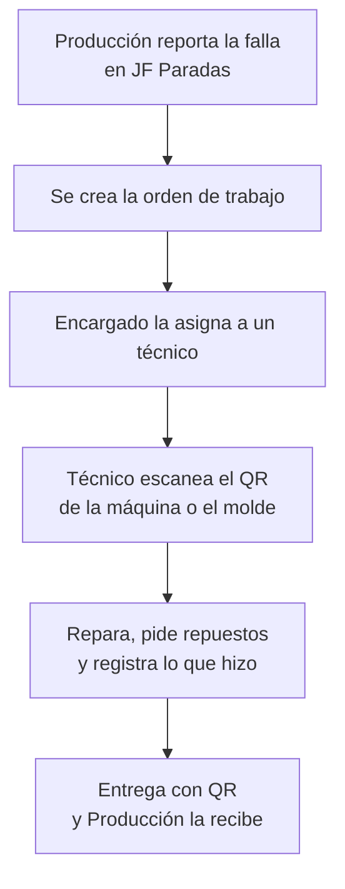
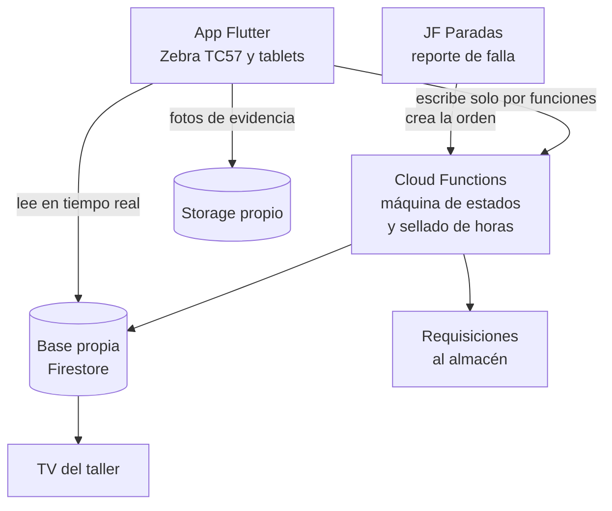
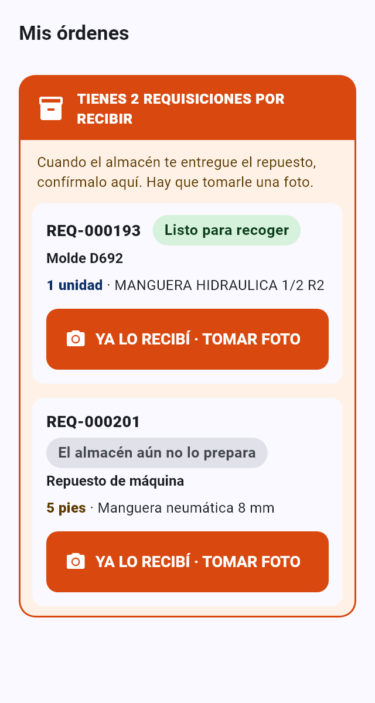
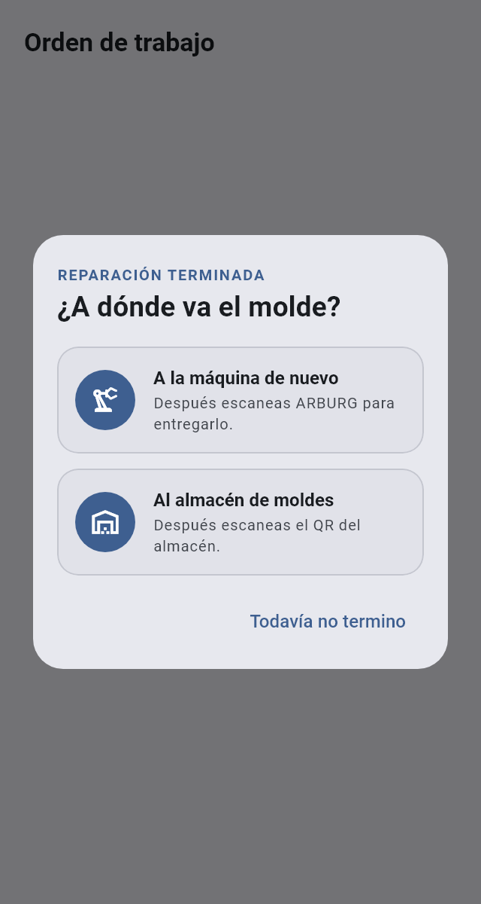

# JF Órdenes de Trabajo · Caso de estudio

> **Este repositorio es un caso de estudio, no contiene código.** El sistema es propiedad de la empresa donde está en producción y su código permanece privado. Aquí se muestra el problema, la solución y cómo funciona.
>
> 🎬 Más proyectos: **[portafolio de Yeison Rojas](https://ai-automation-portfolio-cyan.vercel.app)**

Convierte cada falla que Producción reporta a Mantenimiento o al Taller de Molde en una **orden de trabajo con los tiempos medidos por etapa y un responsable en cada tramo**.

## El reto

Que el tiempo de cada reparación fuera real y que se supiera quién tenía cada orden en cada momento, sin cambiar lo que Producción ya hacía y sin que el técnico tuviera que pensar en el sistema mientras repara.

## La solución

- **La orden nace sola:** Producción sigue reportando la falla en [JF Paradas](https://github.com/yeisondev001/jf-paradas-case-study) y aquí se crea la orden automáticamente.
- **Cada etapa se demuestra escaneando** el QR físico de la máquina, el molde o el sitio con un Zebra TC57, no tocando un botón.
- **El servidor sella las horas:** la app solo lee en tiempo real y escribe a través de funciones del servidor, donde viven la máquina de estados y los permisos. El teléfono no puede alterar los tiempos.
- **Un técnico, una orden activa;** las demás esperan en su cola. Los encargados reparten, validan o anulan desde su teléfono o tablet.
- **Mantenimientos planificados:** preventivos cada N días y autónomos diarios por máquina.
- **Requisiciones de repuestos** al almacén, confirmadas con foto al recibirlas.
- **Movimiento de moldes** entre máquina, taller y almacén con un QR de un solo uso.
- **TV del taller** con cuatro columnas: sin asignar, asignadas, completadas y técnicos con su estado.

## Diseñada para el piso de planta

Los técnicos tocan la pantalla con guantes o con las manos sucias, hay ruido fuerte y algunos leen con dificultad los textos largos. Por eso la interfaz usa botones grandes, avisos visuales en lugar de solo sonidos y textos cortos. Cuando las necesidades del técnico y del encargado chocan, se diseña primero para el técnico.

## Cómo funciona

Cada paso queda con la hora sellada por el servidor y con su responsable.

## Arquitectura

## Decisiones técnicas

- **El cliente pide, el servidor decide.** La app lee en tiempo real y escribe solo a través de funciones del servidor, donde viven la máquina de estados y los permisos. El teléfono no puede adelantar ni alterar las horas.
- **Cada etapa se demuestra escaneando** el QR físico de la máquina, el molde o el sitio; no basta con tocar un botón.
- **Convive con otras apps en el mismo proyecto Firebase sin pisarlas:** base de datos propia, grupo de funciones propio, sitio web propio y almacenamiento propio, para que un despliegue de esta app nunca afecte a las demás.
- **No cambia lo que ya funcionaba:** Producción sigue reportando en JF Paradas; esta app solo lee esos reportes y los marca desde el servidor.
- **Despliegue ordenado:** funciones → reglas e índices → app, y la versión nueva se activa en el cambio de turno porque bloquea los equipos al instante.

## Mi rol

Creador y arquitecto del sistema. Diseñé la arquitectura (máquina de estados en el servidor, escaneo por QR, tiempos sellados por el servidor) y dirigí su desarrollo: mantenimientos planificados, requisiciones, movimiento de moldes, TV del taller e integración con JF Paradas.

## Stack

Flutter (Android en Zebra TC57 con DataWedge) · Firebase (Firestore, Cloud Functions, Storage para evidencias, Hosting) · QR

## Capturas

  
  

---

## English summary

**JF Work Orders** turns every failure that Production reports to Maintenance or the Mold Shop into a **work order with measured time per stage and an owner for each step**.

Orders are created automatically from the downtime reports in [JF Paradas](https://github.com/yeisondev001/jf-paradas-case-study). Technicians prove each stage by scanning the physical QR code on the machine, mold or location with a Zebra TC57. The app reads in real time and writes only through server functions, where the state machine and permissions live, so timestamps are sealed by the server, not the phone. It also handles preventive and daily maintenance plans, spare-part requisitions, mold movements with single-use QR codes, and a TV board for the shop. The UI is built for gloves, noise and short reading time.

**Key engineering decisions:**
- Client asks, server decides: writes only through server functions that own the state machine and timestamps.
- Each stage is proven by scanning a physical QR code.
- Fully isolated database, functions, hosting and storage inside a Firebase project shared with other apps.
- Zero change for Production: it reads the existing downtime reports.

**My role:** creator and architect of the system. I designed the architecture (server-side state machine, QR-based stages, server-sealed timestamps) and led its development.

**Stack:** Flutter (Android, Zebra TC57), Firebase (Firestore, Cloud Functions, Storage, Hosting).

*This is a case study. The source code belongs to the company and stays private.*
